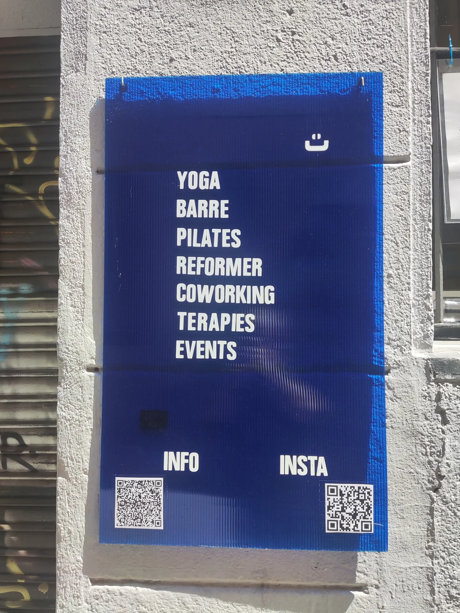
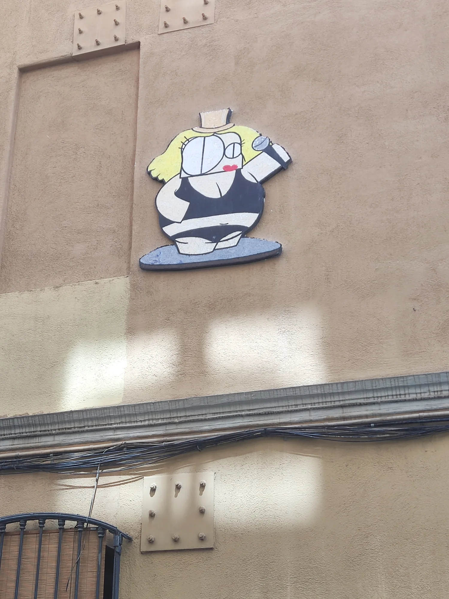
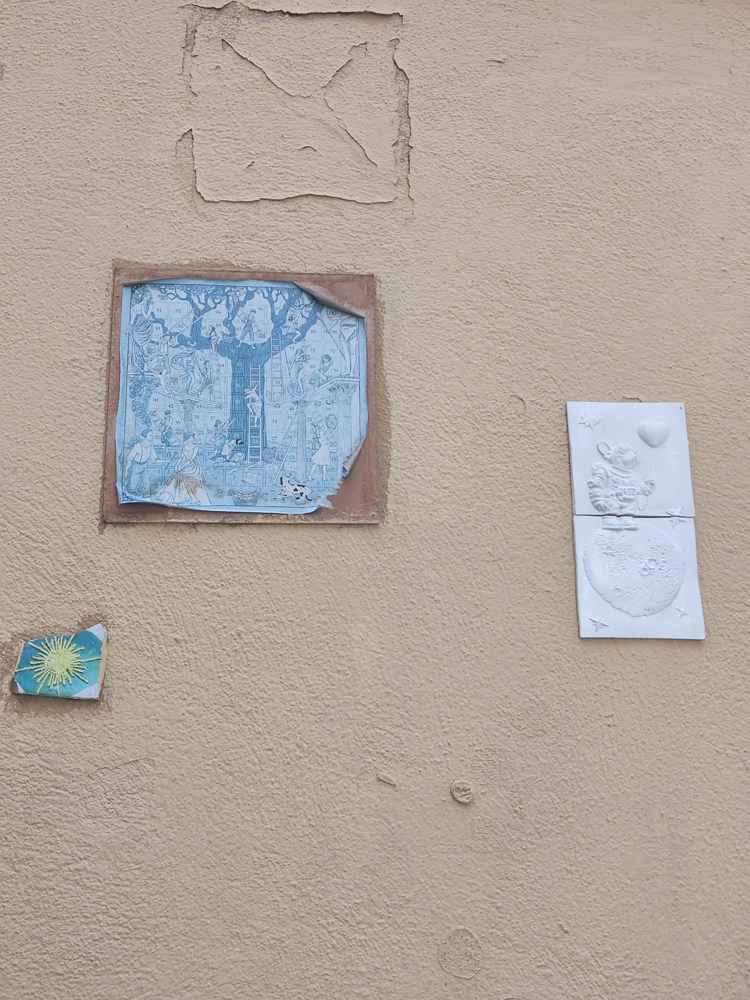

Algunas impresiones de la esquina de Mozart con Domenech, en Gràcia Oeste, cerca de Jardinets. El cartel azul muestra casi todas las actividades típicas de Gràcia 2026. Falta el taller de alfarería y el café de especialidad.

La cantante de la segunda foto está en la calle Domenech al menos desde 2016, así que lleva allí unos diez años. La tercera foto muestra algunas adiciones recientes a la decoración, que seguramente tendrán vida corta.

::: {layout-ncol=2}

{.lightbox group="mozart"}

{.lightbox group="mozart"}

{.lightbox group="mozart"}

:::

