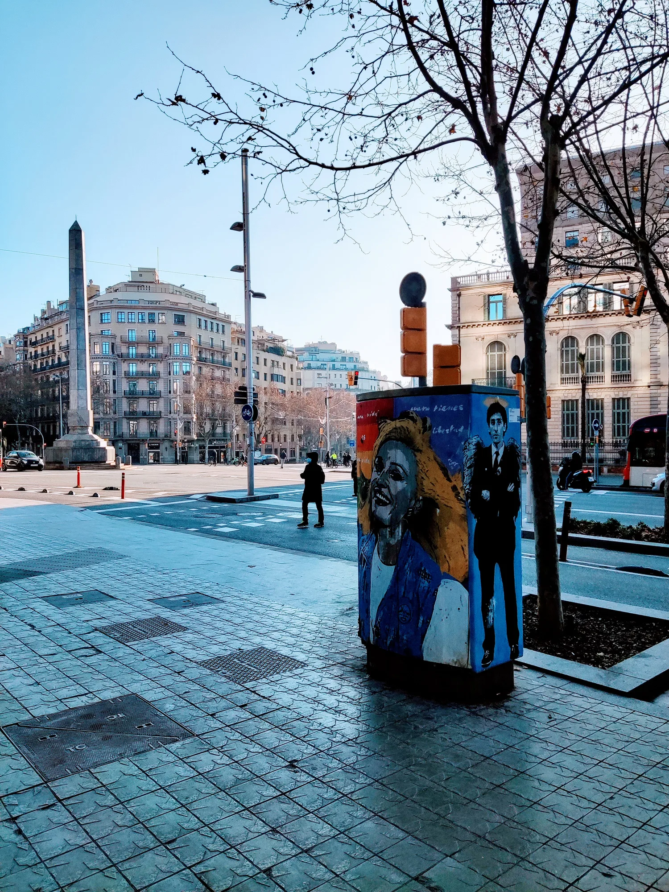
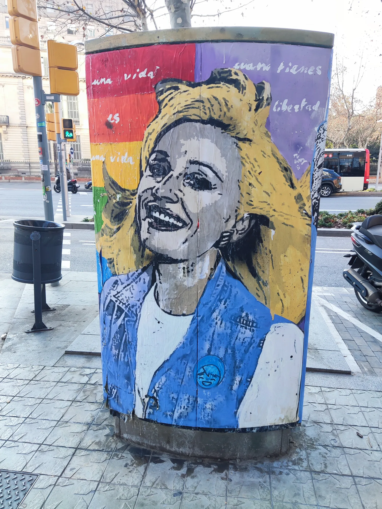
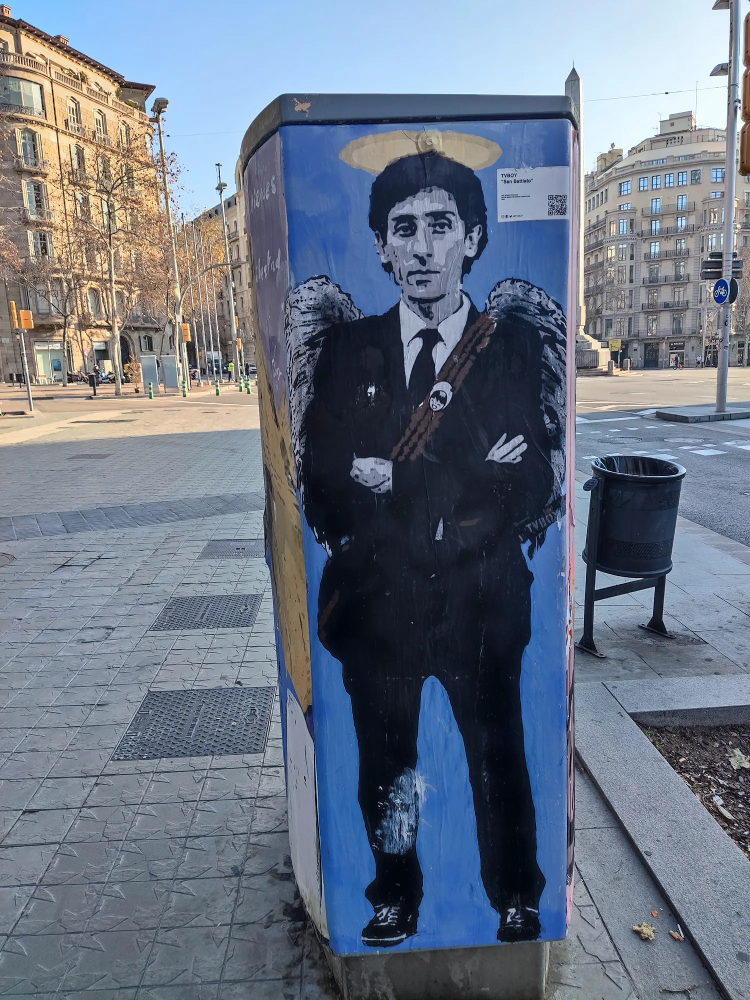
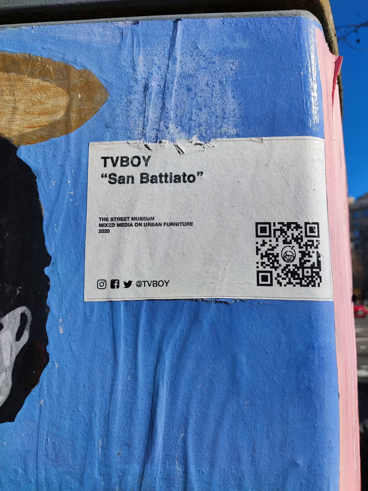
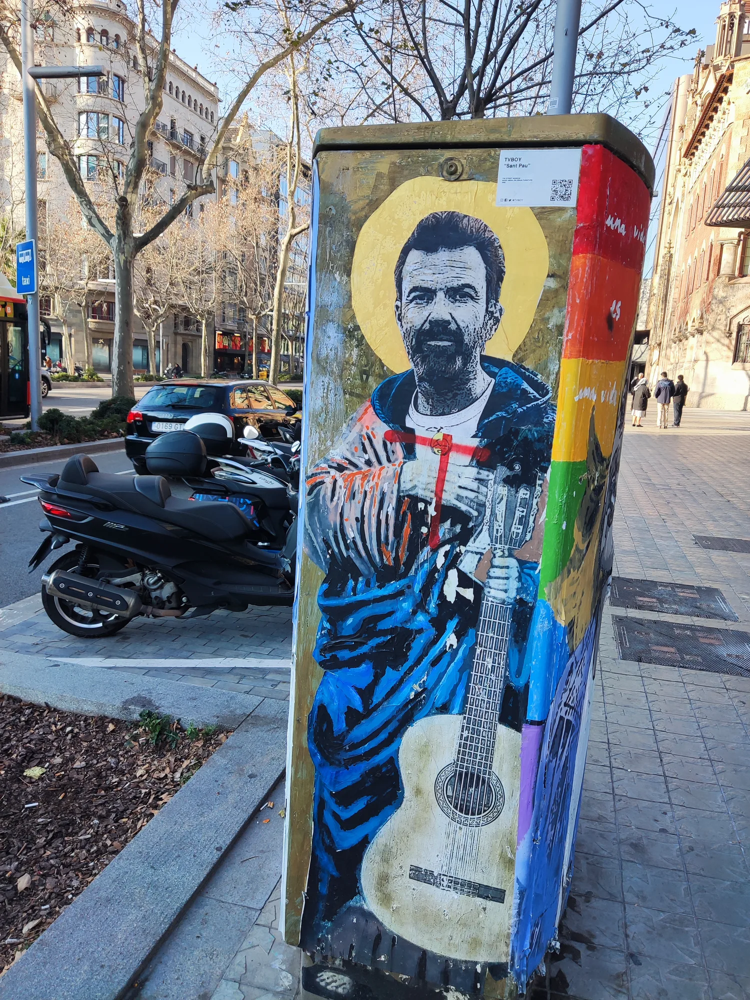
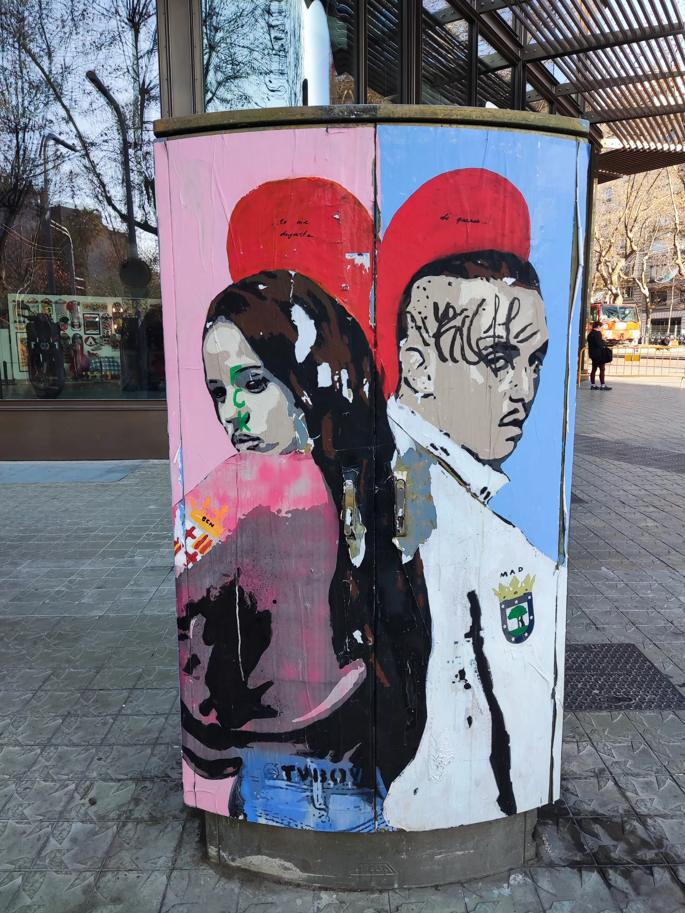

[TVBoy](https://www.tvboy.it/) es un napolitano conocido por sus paste-up de personajes famosos. Su última acción en Barcelona fue presentar un retrato del valenciano Ferran Torres besando la Copa del Mundo, que fue vandalizado al cabo de unas horas.

En 2022 tuvo bastante actividad en un armario situado en la Diagonal cerca de Paseo de Gracia. Aquí se muestran algunos retratos de Franco Battiato, Raffaella Carrá y Pau Donés. Eran artistas populares en ese momento, que habían muerto entre 2020 y 2021. También tenemos un retrato de la entonces pareja Rosalía-Tangana.

::: {layout-ncol=2}

{.lightbox group="tvboy"}

{.lightbox group="tvboy"}

{.lightbox group="tvboy"}

{.lightbox group="tvboy"}

{.lightbox group="tvboy"}

{.lightbox group="tvboy"}

:::

