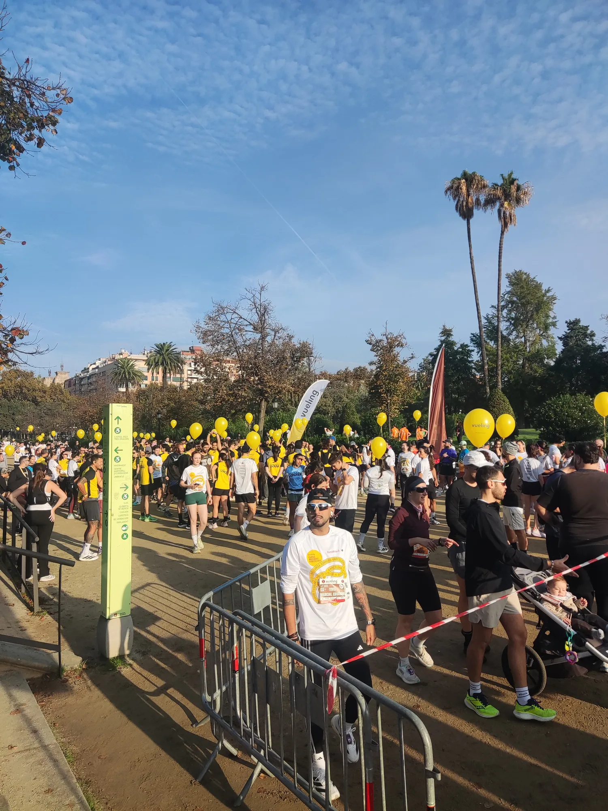
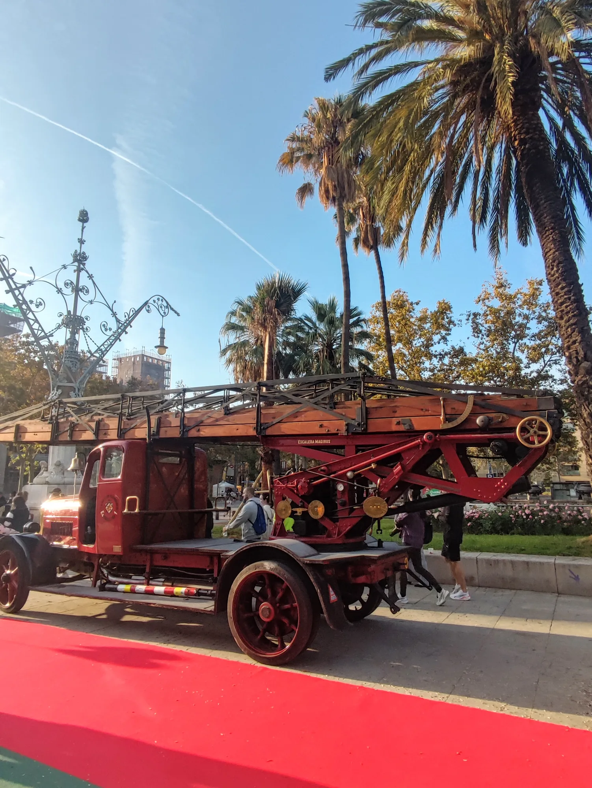
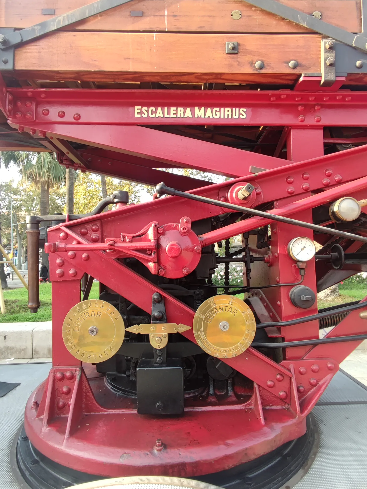
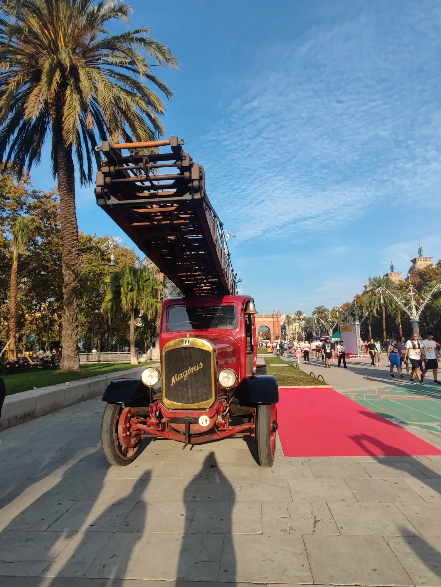
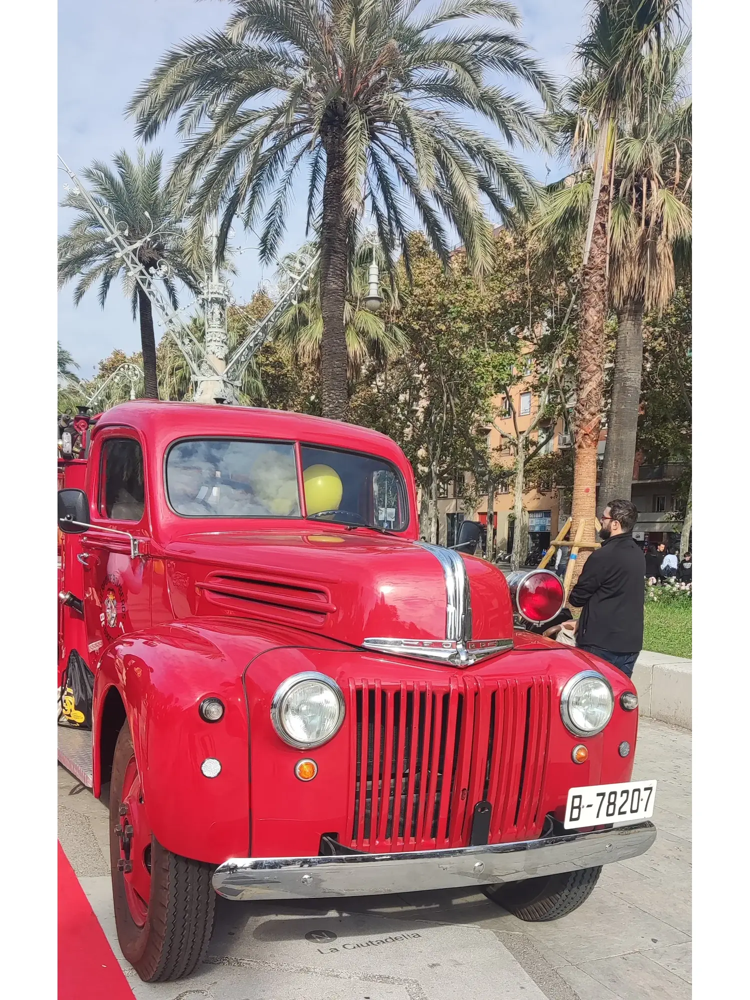
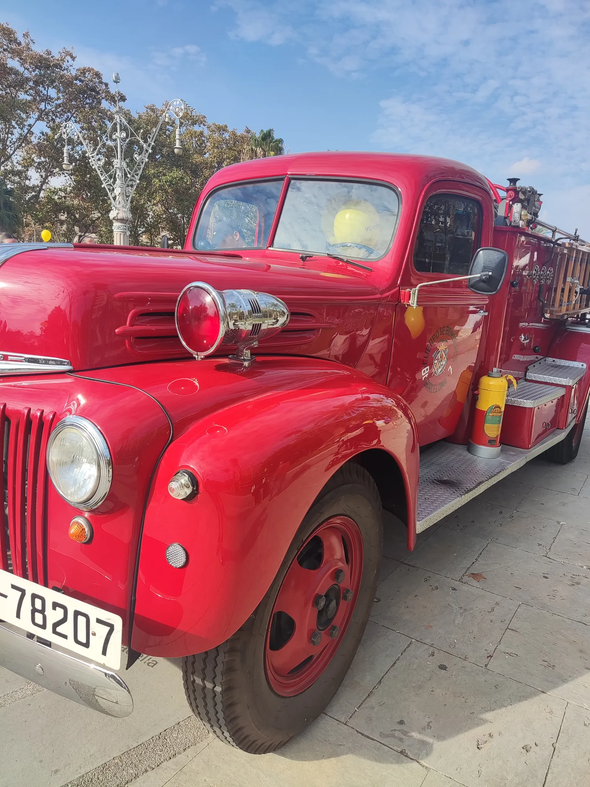

Hoy se ha celebrado la 27a edición de la *Cursa Bombers Barcelona*. Es una carrera popular en homenaje a los bomberos de la ciudad. Algunos de ellos hacen la carrera con el equipamiento de bombero completo. Antes y después de la carrera hemos podido ver algunos camiones clásicos de bomberos, restaurados por Bombers de Barcelona.

::: {layout-ncol=2}

{.lightbox group="bombers"}

{.lightbox group="bombers"}

{.lightbox group="bombers"}

{.lightbox group="bombers"}

{.lightbox group="bombers"}

{.lightbox group="bombers"}

:::

